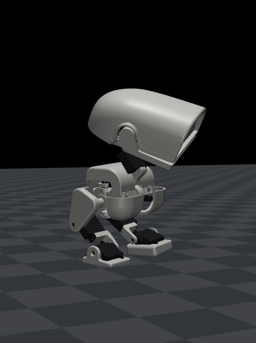

# Duckling

<p align="center">
  
</p>

A ~15 cm, ~190 g bipedal duck robot, and the reinforcement-learning setup that teaches it to walk
and to follow a person at 50 cm. It is a scaled-down, redesigned take on Pollen Robotics' Microduck.

This repository is an adaptation of **[microduck_rl](https://github.com/pollen-robotics/microduck_rl)
by Pollen Robotics**, trained with [mjlab](https://github.com/mujocolab/mjlab) (MuJoCo Warp) and PPO.

## What changed compared to microduck_rl

- **3D models modified:** new, smaller robot (SLA-printed, ~0.65 scale), with a 3-DOF hip
  (yaw plus a pitch/roll differential driven by 6 mm coreless gear motors), servo-driven ankle and toe
  (Emax ES9051), and a 3-DOF head with a neck.
- **New robot description:** `src/mjlab_microduck/robot/duckling/` (MJCF, meshes, gait grids).
- **New tasks:** `duckling_velocity_env_cfg.py` (walking with imitation of a hand-made walk cycle)
  and target following with camera-like perception.
- **Tools:** gait generator (`tools/gait_gen.py`, `tools/walk_speed.py`) and players
  (`tools/duckling_play_onnx.py`, `tools/duckling_follow.py`).

## Quickstart

```bash
chmod +x duck.sh && ./duck.sh setup
./duck.sh update /duck_volg16b.zip
ENVS=8192 ./duck.sh train 2000
```

## Notes

Before updating to 16b, training for 1500 its on duck_basis might me a good idea.

## License and attribution

- **Code:** Apache License 2.0, see [LICENSE](LICENSE). Files from microduck_rl have been modified.
- **3D models:** the original Microduck 3D models are © **Pollen Robotics**
  ([microduck_rl](https://github.com/pollen-robotics/microduck_rl)) and licensed under
  [CC BY-NC-SA 4.0](https://creativecommons.org/licenses/by-nc-sa/4.0/).
  **I have modified these models.** My adapted models (the Duckling meshes) are therefore also licensed under
  [CC BY-NC-SA 4.0](https://creativecommons.org/licenses/by-nc-sa/4.0/)
  ([legal code](https://creativecommons.org/licenses/by-nc-sa/4.0/legalcode)):
  attribution required, **no commercial use**, and adaptations must be shared under the same license.
  See [LICENSE-MODELS.md](LICENSE-MODELS.md) for which files this covers.
